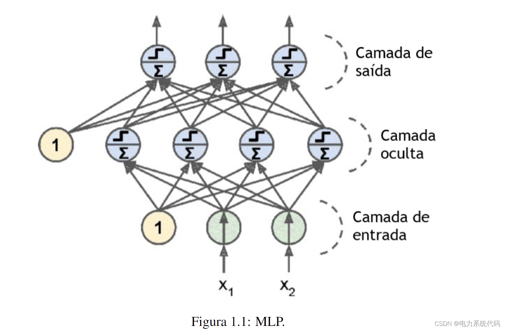
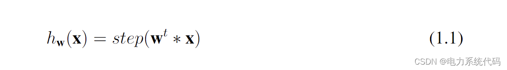
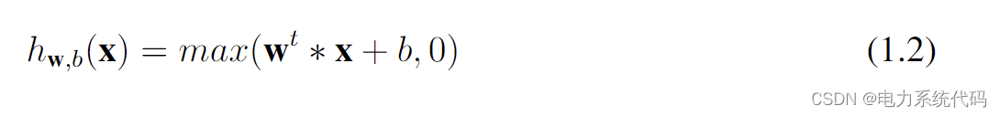
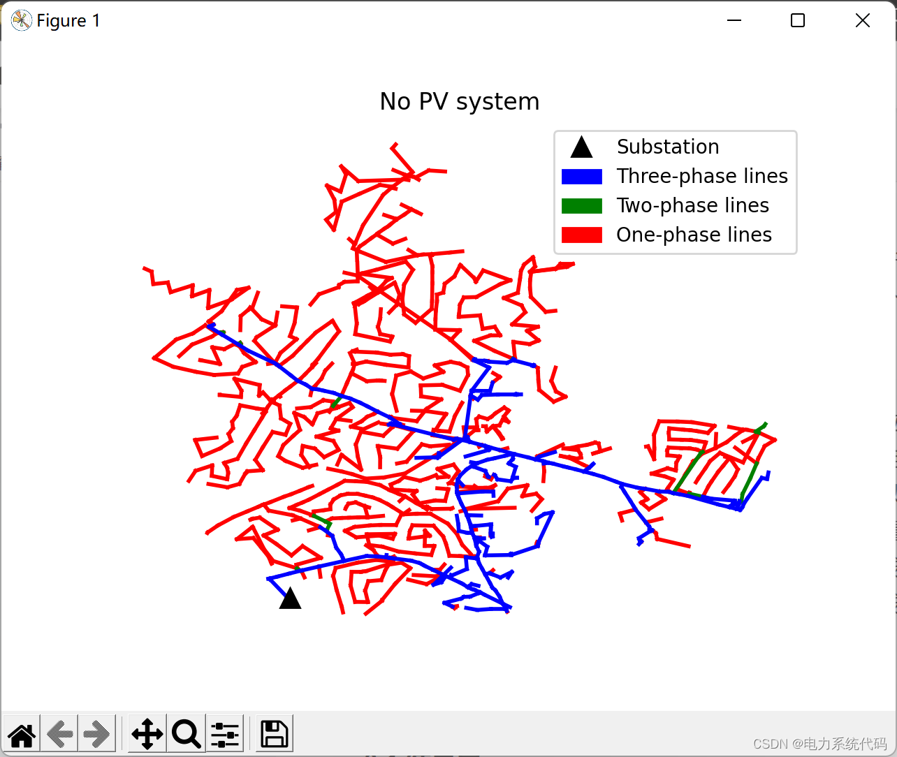
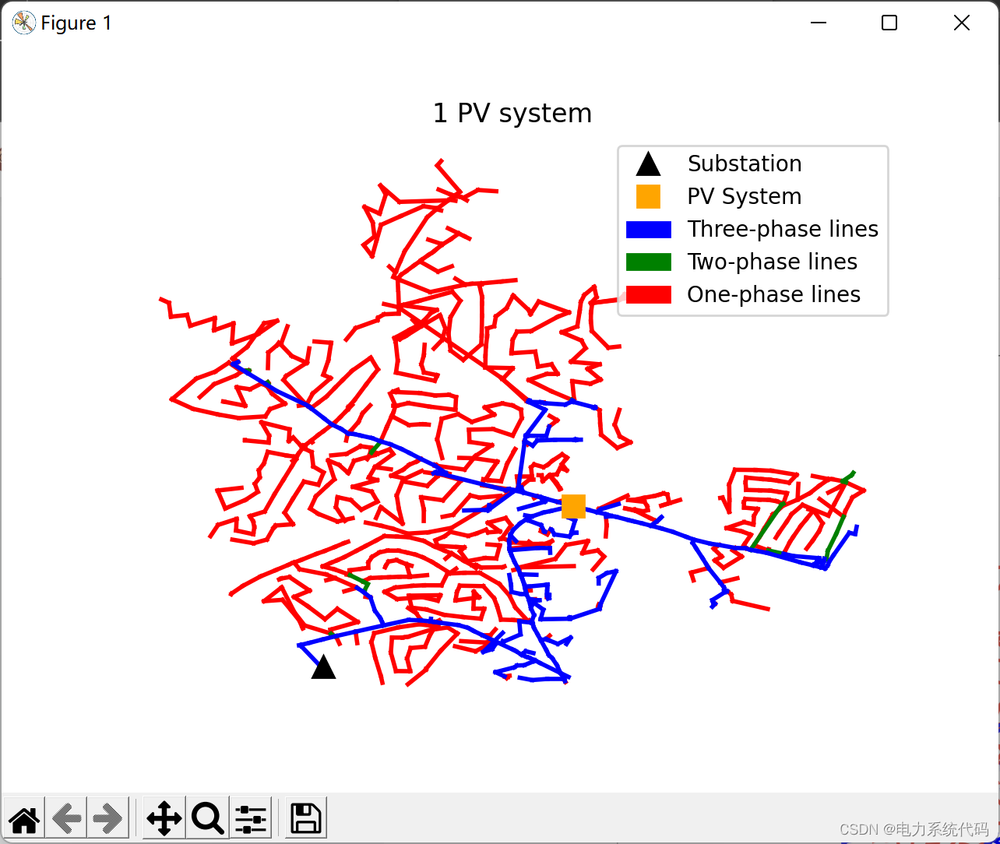
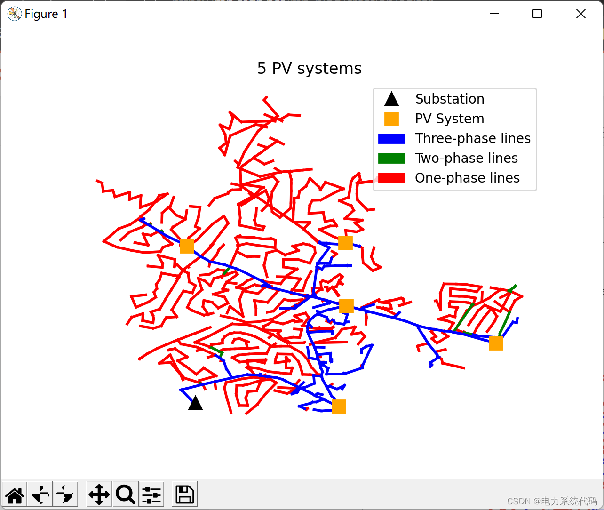
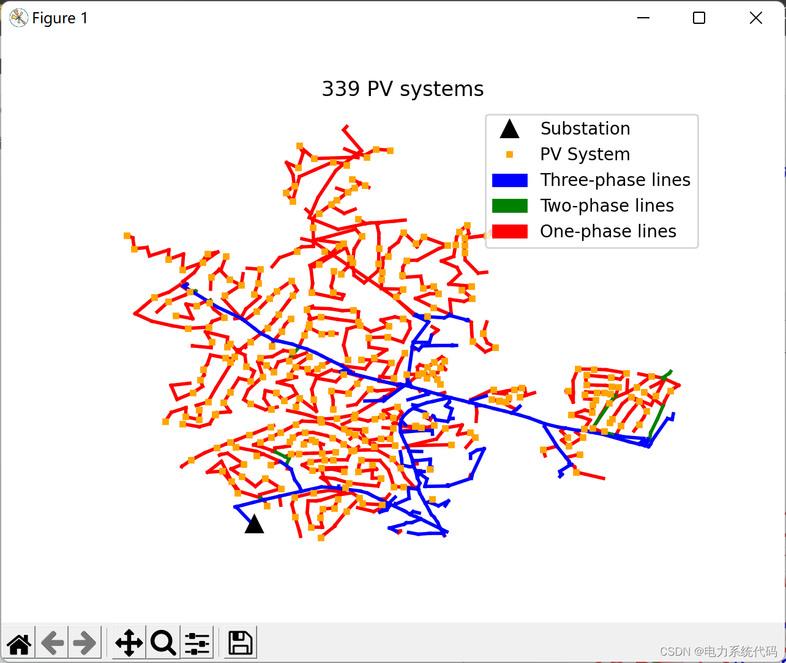

# Impact of Distributed Power Sources on Fault Localization in the Distribution Network (Python Code Implementation)

​  
Contents
1. Overview
2 Objectives
3 Python code implementation
3.1 Results Display
3.2 Python Code
Editor
1. Overview of the increasing reliance on electricity in daily life, making devices that require electricity no longer luxury items but necessities. All parties responsible for providing this resource to the public must address issues related to electricity production, transmission, and distribution. Despite many advances made in power system protection over the past few decades, there is still significant room for improvement in enhancing the continuity of energy supply services. In the context of distribution, taking Brazil as an example, the quality of electricity supply to consumers can be quantified through indicators of continuous distribution services. The National Energy Agency (Aneel) provides two such indicators in [PRODIST 2012], namely the equivalent interruption duration (DEC) per consumer unit and the equivalent interruption frequency (FEC) per consumer unit. The DEC is the average time interval obtained by calculating the average interruptions in the energy distribution service of the relevant consumer units during the calculation period. The FEC is the average frequency of such discontinuities occurring within the considered units.
This paper aims to determine the impact of distributed photovoltaic power generation on the localization of faults in radial distribution networks. The size of the photovoltaic system is determined by the penetration limit of this circuit. Fault simulations are performed on OpenDSS to obtain voltage and current values at substations. These results are recorded in the database and used to train a multi-layer perceptron-based neural network that can identify the location of faults between six potential geographical areas where distributed photovoltaic power generation may or may not be present with an average success rate of 90%.
1.1 MLPMLP is a hierarchical neural network. The input layer receives the problem inputs, the intermediate hidden layers perform mapping operations, and the output layer provides the output, as shown in Figure 1.1. The basic unit of the simulated neuron is called a perceptron. In addition to the perceptron, there is also a bias node in the input layer and the intermediate layer for handling inputs equal to zero.
As a supplement, based on [Goodfellow et al. 2016], the MLP is merely a function y = f(x; θ), which maps the input x to output y using optimized θ parameters. It can be said that according to [Géron 2017], the working principle of perceptrons is to weight the inputs and sum them up, then discretize the total sum according to its sign, as shown in the equation below
As a supplement, the MLP is merely a function y = f(x; θ), which uses optimized θ parameters to map the input x into the output y. It can be said that the working principle of the perceptron is to weight the sum of its inputs and discretize the value of this sum according to its sign, as shown in the equation:
Editor
In which hw is the output of the perceptron, x is the input value, w is the weight assigned to each input, step is the discrete function for the summation, and can be a Heaviside function or signal function.
One method for adjusting the weights of an MLP is through backpropagation techniques. This mechanism involves, after determining the forward weights and their total error of the neural network, recalculating the error contribution of each weight in reverse, proposing new weights with a smaller total error in each iteration. To make this method feasible, the activation function, which is the step function in traditional perceptron structures, must be replaced with a smoothing function, such as a logical function, hyperbolic tangent function, or rectified linear unit (ReLU), as shown in the equation:
Editor
Among them, hw,b(x) is the ReLU function, b is the bias value. In addition, the backpropagation method of calculating the gradient of the function can be used to optimize by random gradient descent. Adam's algorithm satisfactorily completed this role.
2. The objective of this paper is to determine the impact of distributed photovoltaic (PV) power generation on the localization of faults in radial distribution networks. The size of the PV system is determined by the penetration limit of the circuit. Fault simulations are performed on OpenDSS to obtain voltage and current values at substations. These results are recorded in the database and used to train a multi-layer perceptron-based neural network capable of determining the location of faults between six potential geographical areas with or without distributed PV power generation, with an average success rate of 90%. The overall goal is to validate the impact of GDFV in the localization of distribution system faults. Subordinate goals supporting the main objective include: designing different PV systems for distribution feeders under their penetration limits and evaluating their power flow; simulating faults at all busbars of the distribution feeder at different points of the load curve; implementing algorithms that can detect faults and classify them into types, resistance, and geographic locations.
3. Python code implementation
Editor
Editor
Editor
3.2 Python Code
def plot_5_pv():\n\n    ckt24_plot()\n    substation, = pylab.plot([11735514.42],[3709460.816],'k^',\n    markersize=10, label='Substation')\n    pvsyst, = pylab.plot(\n    [11740361.09,11745683.27,11740622.95,11740594.66,11735219.81],\n    [3709237.782,3712746.259,3714771.12,3718243.191,3718067.52],\n    color='orange', marker='s', markersize=10, linestyle='None',\n    label='PV System')\n    blue_patch = mpatches.Patch(color='blue', label='Three-phase lines')\n    green_patch = mpatches.Patch(color='green', label='Two-phase lines')\n    red_patch = mpatches.Patch(color='red', label='One-phase lines')\n    pylab.legend(handles=[substation, pvsyst, blue_patch, green_patch,\n    red_patch])\n    pylab.title("5 PV systems")\n    pylab.show()\n  
​  

## Images

<!-- PAYMENT_BLOCK -->

## Get this dataset

- Payment link (Stripe): [Buy now](https://buy.stripe.com/3cs8yP7sY87d0vu9AB)
- Payment QR code: 

<!-- /PAYMENT_BLOCK -->
